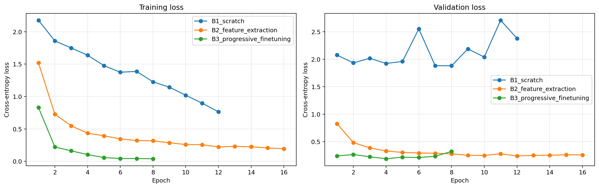
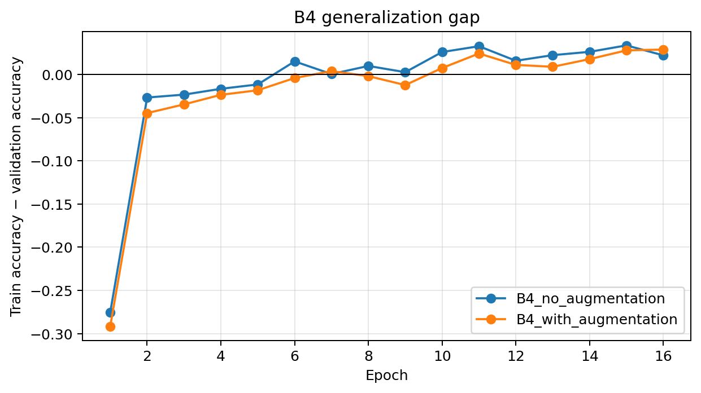

<!-- @format -->

# Bagian C — Laporan Analisis Eksperimen

## Ringkasan Protokol

Eksperimen ini menggunakan 1.981 citra dari sepuluh ras hewan, yaitu Abyssinian, Bengal, Birman, Bombay, British Shorthair, American Bulldog, American Pit Bull Terrier, Basset Hound, Beagle, dan Boxer. Dataset dibagi secara stratified menjadi 1.386 citra training, 297 validation, dan 298 test.

Semua eksperimen menggunakan input berukuran 224 × 224, ImageNet normalization, batch size 32, AdamW, dan `CrossEntropyLoss`. Checkpoint terbaik dipilih berdasarkan validation loss dengan `early stopping` dan patience empat epoch. Test set hanya digunakan setelah checkpoint dipilih melalui validation loss.

## C1 — Tabel Konsolidasi dan Visualisasi Pembelajaran

| Kode | Strategi                                   | Parameter dilatih | Learning rate              | Epoch terbaik / dijalankan | Durasi total | Akurasi validation | Macro F1 test |
| ---- | ------------------------------------------ | ----------------: | -------------------------- | -------------------------: | -----------: | -----------------: | ------------: |
| B1   | From scratch, tanpa augmentasi             |        11.181.642 | 1e-3                       |                     8 / 12 |    474,2 dtk |             39,06% |        36,93% |
| B2   | Feature extraction, dengan augmentasi      |             5.130 | 1e-3                       |                    12 / 16 |    444,7 dtk |             93,27% |        90,59% |
| B3   | Progressive fine-tuning, dengan augmentasi |         8.398.858 | `layer4`: 1e-4; `fc`: 1e-3 |                      4 / 8 |    194,2 dtk |         **95,29%** |        92,25% |
| B4a  | Feature extraction, tanpa augmentasi       |             5.130 | 1e-3                       |                    12 / 16 |    216,2 dtk |             93,94% |    **92,65%** |
| B4b  | Feature extraction, dengan augmentasi      |             5.130 | 1e-3                       |                    12 / 16 |    273,1 dtk |             93,27% |        90,59% |

Durasi training dipengaruhi oleh jumlah epoch yang dijalankan sebelum `early stopping`. B3 memang memiliki durasi total paling singkat, tetapi eksperimen tersebut hanya berjalan selama delapan epoch. Karena itu, durasi total saja belum cukup untuk menyimpulkan bahwa progressive fine-tuning lebih cepat per epoch daripada feature extraction.

**Gambar 1.** Kurva training loss dan validation loss B1–B3. Versi resolusi penuh tersedia di `artifacts/loss_curves_b1_b2_b3.png`.

**Gambar 2.** Generalization gap B4 per epoch, dihitung sebagai selisih antara training accuracy dan validation accuracy.

## C2 — Analisis Komparatif

### From scratch vs. transfer learning

B1 memperoleh Macro F1 test sebesar 36,93%, jauh di bawah semua eksperimen yang menggunakan transfer learning. Training loss memang turun dari 2,177 pada epoch pertama menjadi 0,764 pada epoch terakhir, tetapi validation loss masih berfluktuasi dan relatif tinggi. Checkpoint terbaik diperoleh pada epoch 8, dengan validation loss 1,880 dan validation accuracy 39,06%. Generalization gap pada checkpoint tersebut mencapai 17,51 percentage points.

Hasil ini menunjukkan bahwa ResNet-18 yang dilatih from scratch dapat mempelajari pola dari training data, tetapi performanya pada validation dan test masih rendah. Dengan jumlah data yang terbatas, model tampaknya belum mampu mempelajari representasi visual yang cukup baik untuk membedakan sepuluh ras secara konsisten.

B2 memberikan hasil yang jauh lebih baik. Walaupun hanya 5.130 parameter pada classifier head yang dilatih, model mencapai Macro F1 test sebesar 90,59%. Hal ini dapat dijelaskan oleh penggunaan pretrained backbone dari ImageNet, yang sudah memiliki representasi fitur visual umum seperti edges, textures, shapes, dan pola bulu. Training kemudian berfokus pada pemetaan fitur tersebut ke sepuluh kelas target.

Dibandingkan B1, Macro F1 B2 meningkat sebesar 53,66 percentage points. Pada eksperimen ini, perbedaan tersebut menunjukkan bahwa transfer learning sangat efektif untuk `small-data regime`. Hasilnya juga sesuai dengan konsep feature extraction yang dibahas pada Slide 14–16.

### Feature extraction vs. progressive fine-tuning

Pada eksperimen utama B1–B3, B3 memperoleh validation accuracy tertinggi sebesar 95,29% dan validation loss terendah sebesar 0,188, keduanya pada checkpoint epoch 4. Macro F1 test-nya juga meningkat dari 90,59% pada B2 menjadi 92,25%, atau naik 1,66 percentage points.

Perbedaan utama B2 dan B3 adalah bagian model yang diperbarui selama training. B2 hanya melatih classifier head, sedangkan B3 juga membuka `layer4` agar fitur tingkat tinggi dapat beradaptasi dengan karakteristik visual ras hewan. Dengan cara ini, representasi yang sebelumnya dipelajari dari ImageNet dapat disesuaikan dengan dataset target.

Namun, jumlah parameter trainable meningkat dari 5.130 menjadi 8.398.858. Kurva loss B3 juga menunjukkan pentingnya `early stopping`. Setelah epoch 4, training loss terus menurun, tetapi validation loss tidak lagi membaik secara konsisten dan mencapai 0,320 pada epoch 8.

B3 menggunakan differential learning rate, yaitu 1e-4 untuk `layer4` dan 1e-3 untuk `fc`. Learning rate yang lebih rendah pada `layer4` membatasi besarnya perubahan pada fitur pretrained, sedangkan classifier head menggunakan learning rate yang lebih tinggi untuk menyesuaikan pemetaan ke kelas target. Strategi ini dapat mengurangi risiko `catastrophic forgetting` dibandingkan membuka seluruh backbone sekaligus dengan learning rate yang besar, sesuai pembahasan pada Slide 28–29.

Dengan demikian, progressive fine-tuning memberikan peningkatan performa test dibandingkan B2 pada eksperimen ini. Namun, peningkatan tersebut perlu dipertimbangkan bersama dengan jumlah parameter yang dilatih dan perubahan validation loss selama training.

### Pengaruh augmentasi pada B4

Hasil B4 menunjukkan bahwa augmentasi tidak otomatis meningkatkan performa pada setiap konfigurasi. B4a, yang tidak menggunakan augmentasi, memperoleh Macro F1 test sebesar 92,65% dan validation accuracy 93,94%. Sementara itu, B4b dengan augmentasi memperoleh Macro F1 test sebesar 90,59% dan validation accuracy 93,27%.

Dengan demikian, B4a unggul sebesar 2,06 percentage points pada Macro F1 test dan 0,67 percentage points pada validation accuracy. Pada konfigurasi ini, penggunaan augmentasi tidak menghasilkan peningkatan performa test.

Di sisi lain, B4b memiliki generalization gap pada checkpoint yang lebih kecil, yaitu 1,11 percentage points dibandingkan 1,59 percentage points pada B4a. Artinya, selisih training accuracy dan validation accuracy B4b lebih kecil, tetapi hal tersebut tidak diikuti oleh hasil test yang lebih baik.

Salah satu hipotesis yang dapat diuji adalah bahwa transformasi seperti `RandomResizedCrop`, rotasi, atau `ColorJitter` mengubah detail visual yang relevan untuk membedakan ras, misalnya bentuk wajah, pola bulu, atau proporsi tubuh. Namun, hipotesis ini belum dapat dipastikan hanya dari metrik agregat. Citra dan prediksi model perlu diperiksa untuk mengetahui apakah transformasi tersebut memang memengaruhi ciri pembeda ras.

Hasil ini bukan bukti bahwa augmentasi selalu merugikan. Eksperimen hanya menggunakan satu random seed dan satu konfigurasi transformasi, sehingga belum cukup untuk menarik kesimpulan umum mengenai pengaruh augmentasi pada tugas klasifikasi ini.

## C3 — Failure Analysis

Berdasarkan Macro F1 test, konfigurasi dengan performa terbaik adalah **B4a, yaitu feature extraction tanpa augmentasi**, dengan skor 92,65%.

Namun, log eksperimen yang tersedia saat ini hanya menyimpan metrik agregat dan belum mencakup prediksi per-citra. Karena itu, contoh misklasifikasi dan kemungkinan penyebabnya belum bisa dijelaskan secara valid tanpa memeriksa citra serta prediksi model yang sebenarnya.

Notebook sudah memiliki sel **“Failure analysis (untuk Bagian C3)”**. Setelah sel eksperimen dan ringkasan dijalankan, sel tersebut dapat digunakan untuk menghasilkan:

- `artifacts/failure_analysis_B4_no_augmentation.png`, berisi panel hingga delapan citra test yang salah diprediksi, lengkap dengan actual label, predicted label, dan confidence.
- `artifacts/B4_no_augmentation_misclassified.csv`, berisi path citra, actual label, prediction, confidence, dan kolom hipotesis.

Gambar yang dihasilkan perlu dimasukkan ke laporan akhir. Setiap kesalahan kemudian dianalisis berdasarkan observasi visual, bukan hanya berdasarkan perbedaan antara label aktual dan prediksi.

Beberapa hal yang dapat diperiksa adalah kemiripan bentuk wajah atau pola bulu antarras, occlusion, sudut pengambilan gambar yang ekstrem, pencahayaan yang buruk, atau latar belakang yang lebih dominan daripada objek utama. Penjelasannya harus disesuaikan dengan citra yang benar-benar diamati.

Sebagai contoh, jika suatu citra menampilkan wajah hewan dari samping, hipotesisnya dapat ditulis sebagai _“The side angle may reduce the visibility of facial features used to distinguish the breed.”_ Kalimat tersebut menunjukkan kemungkinan penyebab tanpa menganggapnya sebagai fakta yang sudah terbukti.

Analisis difokuskan pada misklasifikasi dengan confidence tertinggi karena kasus ini memperlihatkan prediksi yang paling meyakinkan tetapi tetap salah. Meski demikian, high confidence tidak otomatis menjelaskan penyebab kesalahan model, sehingga observasi terhadap citra tetap diperlukan.

## C4 — Rekomendasi Rekayasa dan Batasan

Berdasarkan Macro F1 test, konfigurasi yang paling layak dipilih untuk dataset dan protokol ini adalah **B4a, yaitu feature extraction ResNet-18 tanpa augmentasi**. Model ini memperoleh Macro F1 test tertinggi sebesar 92,65%, dengan hanya 5.130 parameter yang diperbarui selama training.

Dari sisi training, pendekatan ini lebih sederhana karena pretrained backbone tetap dibekukan dan hanya classifier head yang dilatih. Jumlah trainable parameters dan optimizer state yang perlu dikelola juga lebih sedikit dibandingkan progressive fine-tuning.

B3 tetap menjadi alternatif yang kuat jika validation accuracy dijadikan kriteria utama atau jika domain target membutuhkan adaptasi fitur lebih lanjut. B3 memperoleh validation accuracy tertinggi sebesar 95,29%, tetapi melatih sekitar 8,4 juta parameter dan memiliki Macro F1 test 0,40 percentage points lebih rendah daripada B4a.

Rekomendasi B4a terbatas pada dataset dan protokol yang digunakan dalam eksperimen ini, khususnya ketika data relatif terbatas dan anggaran training menjadi pertimbangan. Perlu dicatat bahwa keuntungan feature extraction terutama berada pada proses training. Kedua konfigurasi tetap menggunakan ResNet-18 untuk inference, sehingga jumlah parameter trainable yang lebih sedikit tidak otomatis menghasilkan model berukuran lebih kecil atau inference latency yang lebih rendah.

Jika model nantinya digunakan pada data dengan variasi pencahayaan, sudut pengambilan gambar, atau kamera yang lebih beragam, augmentasi perlu diuji kembali. Pemilihan transformasi juga perlu mempertimbangkan apakah ciri visual yang membedakan ras masih terlihat setelah citra diubah.

Eksperimen ini memiliki beberapa keterbatasan:

- **Single random seed.** Hasil hanya diperoleh dari seed 42, sehingga variasi performa antarseed belum diukur.
- **Limited class coverage.** Eksperimen hanya menggunakan sepuluh dari 37 kelas Oxford-IIIT Pet. Hasilnya belum tentu berlaku untuk semua kelas dalam dataset.
- **Limited hyperparameter search.** Learning rate, augmentation configuration, dan patience belum melalui pencarian hyperparameter yang luas.
- **Hardware-dependent duration.** Durasi training dipengaruhi oleh lingkungan komputasi dan tidak dapat langsung dijadikan benchmark universal.
- **Limited augmentation configurations.** B4 hanya menguji satu paket augmentasi. Kombinasi transformasi dan intensitas lain belum dievaluasi.

Dengan mempertimbangkan keterbatasan tersebut, B4a merupakan pilihan berdasarkan hasil eksperimen yang tersedia, bukan bukti bahwa feature extraction tanpa augmentasi selalu menjadi strategi terbaik untuk klasifikasi ras hewan.

## Artefak Verifikasi dan Pernyataan Penggunaan AI

Untuk mendukung verifikasi hasil eksperimen, sertakan artefak berikut:

- `experiment_summary.csv`
- `experiment_summary.json`
- Seluruh file `*_epoch_metrics.csv`
- `split_manifest.csv`
- `artifacts/loss_curves_b1_b2_b3.png`
- `artifacts/b4_generalization_gap.png`
- CSV dan gambar failure analysis setelah sel C3 dijalankan

**Pernyataan penggunaan AI.** AI digunakan untuk membantu menyusun kodingan, debugging error DataLoader pada Windows, dan merapikan struktur laporan. Semua terdapat pada log yang tersimpan di folder `artifacts`.
